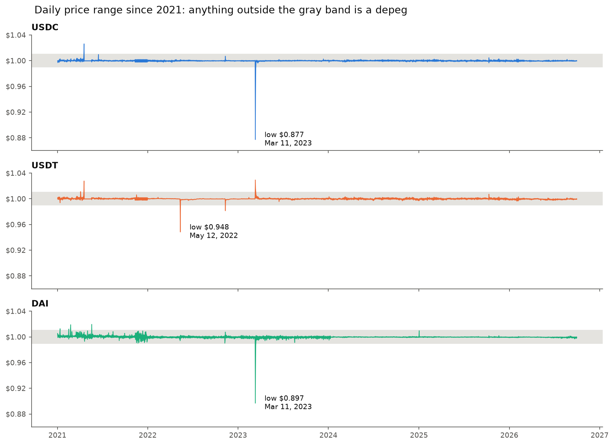
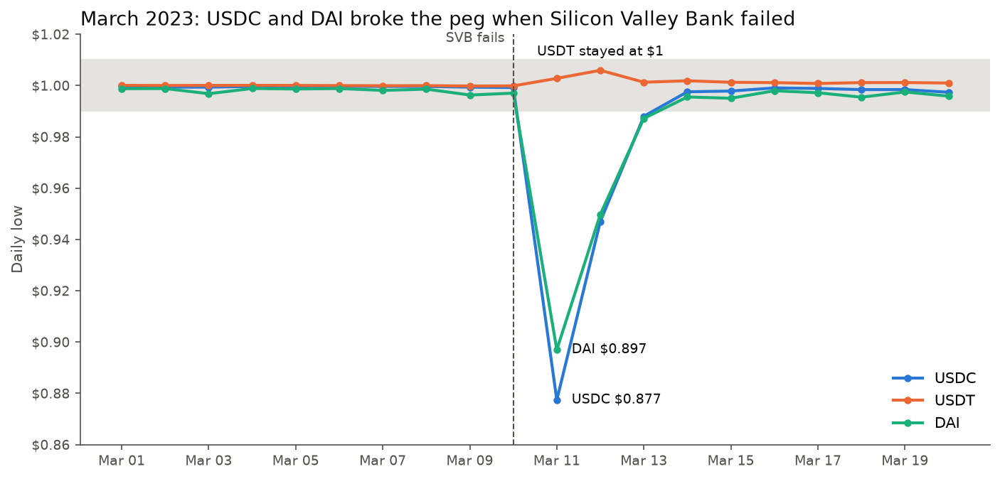

# Stablecoin Depeg Monitor

## The question
How often have USDC, USDT, and DAI lost their $1 peg since 2021, how badly, and which one held up best?

## The answer
**No coin wins on every measure. USDC was the steadiest day to day but had the single worst crash. USDT had the shallowest worst case.**

- **USDC** stayed within half a cent of $1 on **99.86%** of days, with a typical day just **0.01 cents** from $1. But it also had the worst event: a fall to **$0.877** on March 11, 2023, when Silicon Valley Bank failed.
- **USDT** never fell below **$0.948** (the Terra collapse, May 2022), the mildest worst case of the three.
- **DAI** was the least stable. It had the fewest days within half a cent (**99.43%**) and fell to **$0.897** in March 2023 because much of it was backed by USDC.

Across all three coins I found **12 depeg events between January 2021 and September 2026, and only 4 were drops below $0.99.** The other 8 were the price trading *above* $1.01, mostly during 2021. Every event lasted 3 days or less.

## My hypothesis, and how it held up
**Hypothesis:** USDC would hold its peg best and DAI would suffer the worst fall, because USDC is far more widely used and DAI has fewer buyers to step in when it slips.

**Result: half right.** USDC was the steadiest day to day, but it had the worst fall, not DAI. Wide use keeps a stablecoin steady in normal times, but it can't protect it when people doubt the reserves behind it. DAI's worst moment came on the same day for the same reason, because much of DAI was backed by USDC.

## My rule for a depeg
A day counts as a depeg if the **daily low falls below $0.99 or the daily high rises above $1.01**. I use the low and high, not the close, because depegs often recover within hours and the close can hide them.

Consecutive flagged days count as **one event**, so a three-day slide counts once, not three times.

Why a 1-cent line: on a typical day these coins close **0.01 to 0.03 cents** from $1, and even the 99th percentile day is under **half a cent** for every coin. A 1-cent line is more than twice that, so it catches real problems without false alarms.

## Comparison
| Coin | Days within $0.995 to $1.005 | Typical distance from $1 | Depeg events | Drops below $0.99 | Worst price |
|---|---|---|---|---|---|
| USDC | 99.86% | 0.011¢ | 2 | 1 | $0.877 |
| USDT | 99.86% | 0.031¢ | 5 | 2 | $0.948 |
| DAI  | 99.43% | 0.022¢ | 5 | 1 | $0.897 |

**For a treasury team:** if the main fear is one sharp loss, USDT had the shallowest worst case in this period. If it's everyday reliability, USDC was the steadiest. A $10 million USDC position would have been down about **$1.2 million** at the March 2023 low, before recovering within three days.

## The worst events
| Coin | Dates | Days | Worst price | What happened |
|---|---|---|---|---|
| USDC | Mar 11 to 13, 2023 | 3 | $0.877 | Silicon Valley Bank, which held part of USDC's reserves, failed |
| DAI | Mar 11 to 13, 2023 | 3 | $0.897 | Much of DAI was backed by USDC |
| USDT | May 12, 2022 | 1 | $0.948 | Terra/UST collapse triggered a run on stablecoins |
| USDT | Mar 11 to 13, 2023 | 3 | $1.030 | Traded *above* $1 as money fled USDC |
| USDT | Nov 10, 2022 | 1 | $0.982 | FTX collapse |

The full list is in [`data/depeg_events.csv`](data/depeg_events.csv).

## The biggest event: March 2023

USDC fell to about $0.88 the day after Silicon Valley Bank failed, and DAI followed because much of it was backed by USDC. Both were back near $1 by March 13, after regulators said all deposits would be protected. USDT went the other way and traded above $1.01 as people moved out of USDC.

## How I did it
1. Downloaded daily high, low, and close prices for USDC, USDT, and DAI from Yahoo Finance (2,099 days, no gaps)
2. Checked every price that crossed $0.99 or $1.01 against a second source (daily candles from the Coinbase and Bitstamp exchanges). I **removed 34 bad prices on 25 days** that the exchanges didn't confirm, including impossible highs of $2.35 for USDC and $3.67 for DAI on Nov 16, 2021, and a fake USDT dip to $0.990 in May 2026
3. Measured normal day-to-day behavior to set the threshold
4. Flagged days outside the threshold and grouped consecutive days into events, ranked by how far the price got from $1
5. Compared the coins on stability, frequency, and severity

The full analysis is in [`notebooks/01_depeg_analysis.ipynb`](notebooks/01_depeg_analysis.ipynb).

## Data and tools
Yahoo Finance via yfinance · Coinbase and Bitstamp public APIs for cross-checking · Python (pandas, Matplotlib)

## Limits
- Daily data can miss very short depegs, and one day's low doesn't say how long the price stayed there
- Free price data contains bad records. I checked every flagged price against a second exchange, but three USDT highs from April 2021 had no second source and are kept as unverified
- The second sources are single exchanges, and a few 2021 DAI closing prices that look off were left in (they make DAI look slightly less stable, not more)
- Past stability doesn't guarantee future stability
